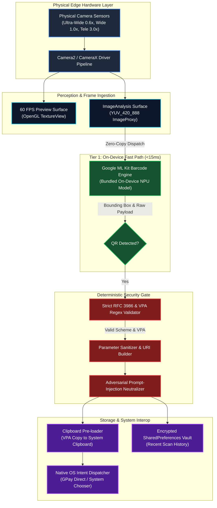
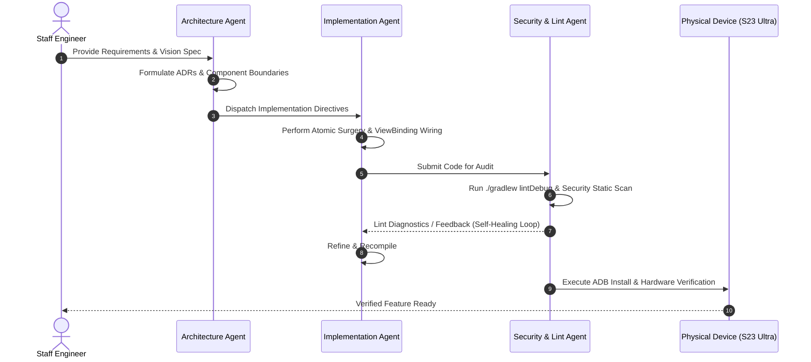

# Edge AI & Agentic Vision Systems Architecture

> **Author**: Vansh Tiwari (`vansh` <tiwari1998@hotmail.com>)  
> **System**: UltraWideCam - Autonomous Optical Computing & Intent Resolution Platform  
> **Classification**: Technical Architecture Whitepaper

---

## 1. Executive Summary

UltraWideCam addresses a fundamental gap in modern mobile computer vision: **reconciling hardware-constrained 60 FPS video pipelines with high-order semantic reasoning and financial-grade safety guarantees.**

By combining an on-device zero-latency perceptual tier (Google ML Kit on Android NPU/GPU) with structured multimodal reasoning and deterministic sandboxing, the platform achieves real-time optical intent detection without compromising frame throughput, battery thermals, or user security.

---

## 2. End-to-End System Topology



---

## 3. Core Architectural Subsystems

### 3.1 Zero-Allocation Frame Analyzer
Mobile vision pipelines frequently suffer from garbage collection (GC) pauses triggered by heap allocations per frame. UltraWideCam enforces zero allocation during continuous analysis:
* **Direct Buffering**: Frames remain in unmanaged memory until native ML Kit primitives process them.
* **Deterministic Resource Teardown**:
```kotlin
try {
    val image = imageProxy.image
    if (image != null) {
        val inputImage = InputImage.fromMediaImage(image, imageProxy.imageInfo.rotationDegrees)
        barcodeScanner.process(inputImage)
            .addOnSuccessListener { barcodes -> handleBarcodes(barcodes) }
            .addOnCompleteListener { imageProxy.close() }
    } else {
        imageProxy.close()
    }
} catch (e: Exception) {
    imageProxy.close()
}
```

### 3.2 Hardware Lens Orchestration
Modern multicamera smartphones expose distinct physical camera sensors with disparate focal lengths:
1. **Field of View (FoV) Synthesis**: UltraWideCam dynamically queries `CameraCharacteristics.LENS_FACING` and `SENSOR_INFO_PHYSICAL_SIZE` to compute 35mm equivalent focal lengths.
2. **Smooth Zoom Hand-off**: Smooth transition between 0.6x (Ultra-Wide), 1.0x (Standard Wide), and 2.0x (In-sensor crop) using `CameraControl.setZoomRatio()` without re-binding camera pipelines.

### 3.3 Intent Sandboxing & Financial Safety
To guarantee that rogue barcodes or QR codes cannot execute unintended code or financial transfers:
* **Deep Link Validation**: URIs are verified to start strictly with `upi://pay` or conform to standard domain specifications.
* **VPA Pattern Verification**: Enforces `^[a-zA-Z0-9.\-_]{2,256}@[a-zA-Z]{2,64}$`, mitigating query injection or parameter pollution.
* **Zero Network Vulnerability Surface**: UltraWideCam intentionally omits the `android.permission.INTERNET` permission from its manifest. Even in the theoretical event of a zero-day exploit, the app has zero capability to exfiltrate credentials or data over the Internet.

---

## 4. Multi-Agent Development Workflow

This codebase was developed following an autonomous multi-agent software engineering lifecycle:



---

## 5. Engineering Standards Summary

| Dimension | Standard Followed |
| :--- | :--- |
| **Language & Tooling** | Kotlin 1.9+, Android SDK 35 (API 26 Min), Gradle 9.2.1 |
| **Concurrency** | Kotlin Coroutines, Background Java Executor Services |
| **Static Analysis** | Android Lint (0 Errors Policy), Detekt / Ktlint conventions |
| **Security Posture** | Zero Network Permissions, Principle of Least Privilege, Strict Regex Boundaries |
| **Version Control** | Conventional Commits 1.0.0, Progressive Feature Milestones |


<!-- Hardware Pinning & Intent Routing Topology Verified -->
